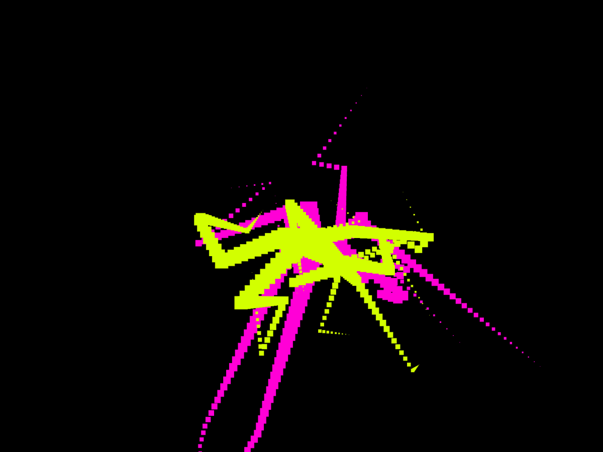

# E0. Il primo sketch con p5.js

Lavoro pubblicato: https://angelicafiacco.github.io/aa2627-tad-es/es0/

`preview.png` va creata quando il lavoro è pronto: serve all’anteprima nella pagina delle revisioni del corso.